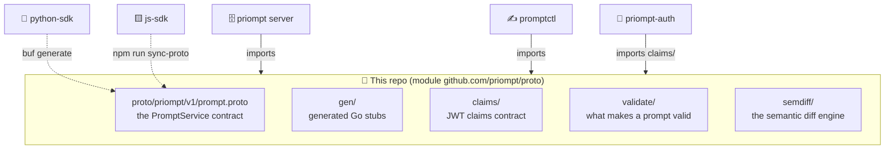

# priompt proto

**The rulebook of Priompt.** Everything the family of repos must *agree* on —
what the API looks like, what a token claims, what makes a prompt valid, how
an edit's meaning is measured — is defined once, in this repo, and imported
everywhere else. No other repo carries a copy that can drift.

## The 30-second version

A gRPC project lives or dies by one thing: the server and every SDK speaking
the *same* contract. The moment each repo keeps its own copy of the `.proto`,
someone adds a field on one side, forgets the other, and clients break in ways
no test catches. The same failure mode applies to any hand-synced code — this
family had a storage engine drift exactly that way before this repo existed.

So the shared things live here, and there is exactly one of each:



Solid arrows are Go imports — the compiler enforces agreement. Dotted arrows
are generation/vendoring steps — one command each, documented below.

## What's inside

| Package | What it defines | Who uses it |
| --- | --- | --- |
| `proto/priompt/v1/prompt.proto` | The `PromptService` gRPC API: 11 RPCs (get, publish, diff, history, branch, merge, rollback, list prompts, list branches, list commits) and every message on the wire | The server implements it; every client speaks it |
| `gen/` | Go stubs generated from the `.proto` (committed — consumers just import) | server, promptctl |
| `claims/` | The JWT claims contract (`sub`, `org`, `rw`, `exp`, `iat`, `iss`) between the priompt-auth issuer and the server's verifier | auth (minting), server (verifying) |
| `validate/` | Prompt well-formedness — the one definition of "valid": non-empty template, every `{placeholder}` declared, every slot used | server (on write *and* serve), promptctl (on commit) |
| `semdiff/` | The Semantic Propagation Diff engine: LCS hunks, embedding distance at the change, ripple analysis outward — plus the swappable `Embedder` interface (offline lexical fallback, or any OpenAI-compatible endpoint) | server (`DiffPrompt`, publish verdicts), promptctl (`diff`) |

Why the engines and not just the schemas? Because a "verdict" only means
something if everyone computes it the same way: a prompt that promptctl calls
valid must be one the server will serve, and a diff promptctl calls a
`localized tweak` must be the verdict subscribers receive. Shared definitions
are contracts, whether they're written in protobuf or Go.

## Changing the contract

Requires [buf](https://buf.build/docs/installation) — remote plugins, no
`protoc`, nothing else to install.

```sh
# 1. edit proto/priompt/v1/prompt.proto (add fields — never renumber or reuse)
buf generate            # 2. regenerate gen/ (committed; never hand-edit)
buf breaking --against .git#branch=main   # 3. prove you broke nobody

# 4. propagate to the two non-Go consumers:
cd ../python-sdk && buf generate          # regenerates priompt/v1/prompt_pb2*.py
cd ../js-sdk    && npm run sync-proto     # re-vendors the .proto (loaded at runtime)
```

Changing `claims/`, `validate/`, or `semdiff/` needs no step 4 — the Go
consumers pick the change up on their next build, and refusing to compile *is*
the sync mechanism.

The honest fine print:

- **js-sdk keeps a vendored copy** of the `.proto` — an npm package must be
  self-contained, and the client loads the file at runtime (no codegen). It is
  a declared artifact refreshed by `npm run sync-proto`, not a hand-synced
  fork.
- **python-sdk commits its generated stubs** so the wheel ships them; they are
  artifacts of this repo's `.proto`, regenerated by `buf generate` there.
- **The Go module is `github.com/priompt/proto`**, versioned by `v*` tags.
  Dependents require a tagged version. To change it alongside a dependent
  repo, use a `go.work` in the parent directory
  (`go work init ./proto ./priompt`) instead of a `replace`.

## Relation to the other repos

| Repo | Role |
| --- | --- |
| **priompt** | Implements `PromptService`, verifies `claims/`, runs `validate/` + `semdiff/` server-side |
| **cli** | `promptctl` — speaks the contract, runs `validate/` + `semdiff/` locally at authoring time |
| **auth** | Mints the JWTs whose payload `claims/` defines |
| **python-sdk / js-sdk** | Generate from / vendor the `.proto` (dotted arrows above) |
| **db-adapters** | The other shared library (storage) — independent of this one |

Tests: `go test ./...` (covers `semdiff` and `validate`; the schemas are
exercised by every other repo's suite).
